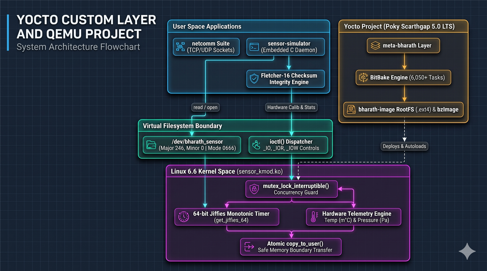
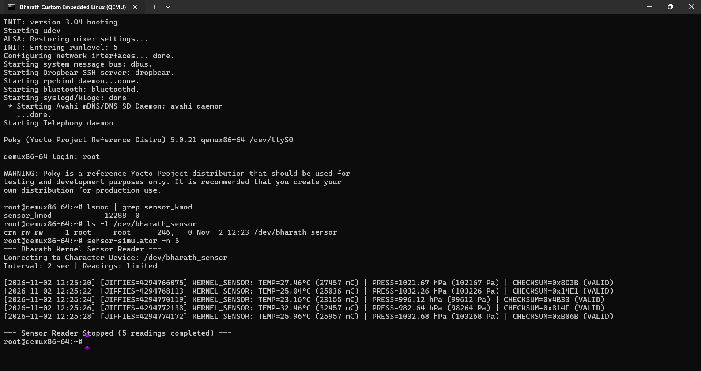

# Yocto Custom Image with meta-bharath Layer

> **Engineered a custom Yocto (Poky Scarthgap 5.0) Linux image for QEMU x86-64 featuring an out-of-tree Linux 6.6 Kernel Character Driver (`/dev/bharath_sensor`), a user-space telemetry daemon with Fletcher-16 checksum integrity, and a POSIX TCP/UDP socket networking suite.**

A complete, production-grade Yocto Project build creating an embedded Linux distribution for **QEMU x86-64**, powered by the custom BSP layer **`meta-bharath`**:

1. **`sensor-kmod`** — An out-of-tree Linux 6.6 character device driver registering `/dev/bharath_sensor` with dynamic major allocation, `class_create` (single-argument Linux 6.4+ API), and `eudev` auto-node generation streaming 64-bit jiffies timestamps, temperature (m°C), and atmospheric pressure (Pa).
2. **`sensor-simulator`** — An embedded user-space C daemon reading binary telemetry directly from `/dev/bharath_sensor` and verifying frame integrity via Fletcher-16 checksum calculations.
3. **`netcomm`** — POSIX TCP and UDP client-server networking suite validating kernel network stack and IPC functionality.
4. **`bharath-image`** — Tailored embedded Linux rootfs image with dropbear SSH, networking utilities, and automated module autoloading.



---

## ⚡ Quick Run (Instant Play without 60 GB Yocto Build)

If you just want to test this custom operating system without compiling from source, you do **not** need to install Yocto or download 60 GB of Poky source code!

You can run the pre-built Linux kernel (`bzImage`) and root filesystem (`bharath-image-qemux86-64.rootfs.ext4`) directly using standalone QEMU in under two minutes:

### 1. Download Release Binaries (~109 MB)
Download `bzImage` and `bharath-image-qemux86-64.rootfs.ext4` from the **[GitHub Releases (v1.0.0)](https://github.com/BharathGDevadiga/yocto-custom-image/releases/tag/v1.0.0)** page.

### 2. Boot in QEMU with a Single Command

#### On Linux or WSL:
```bash
# Automated helper script
chmod +x run-prebuilt.sh
./run-prebuilt.sh
```

#### On Windows:
Double-click **`run-prebuilt-windows.bat`** in File Explorer (or run it from PowerShell/CMD).

#### Manual Direct QEMU Invocation:
```bash
qemu-system-x86_64 \
    -kernel bzImage \
    -drive file=bharath-image-qemux86-64.rootfs.ext4,if=virtio,format=raw \
    -append "root=/dev/vda rw console=ttyS0 console=ttyS1 quiet" \
    -cpu IvyBridge,-x2apic,-tsc-deadline \
    -machine q35,i8042=off \
    -smp 4 \
    -m 256 \
    -serial mon:stdio \
    -serial null \
    -nographic
```

### 3. Log In & Verify
* When prompted, log in with username: **`root`** (no password required).
* Verify driver: `lsmod | grep sensor_kmod`
* Verify device node: `ls -l /dev/bharath_sensor`
* Run telemetry client: `sensor-simulator -n 5`
* **Clean Exit:** Simply type **`poweroff`**!

---

## Project Structure

```text
yocto-custom-image/
├── README.md
├── run-prebuilt.sh             # One-click standalone QEMU launcher
├── setup-build.sh              # Automated build environment setup
├── build-yocto.sh
├── .gitignore
├── Yocto_Embedded_Linux_Project_Guide.pdf  # Comprehensive architecture & walkthrough guide
└── meta-bharath/               # Custom Yocto layer
    ├── conf/
    │   └── layer.conf          # Layer configuration (scarthgap compatible)
    ├── recipes-apps/
    │   ├── sensor-simulator/
    │   │   ├── sensor-simulator_1.0.bb    # User-space BitBake recipe
    │   │   └── files/
    │   │       └── sensor-simulator.c     # Kernel character device reader & Fletcher-16
    │   └── netcomm/
    │       ├── netcomm_1.0.bb             # Network suite BitBake recipe
    │       └── files/
    │           ├── tcp-server.c           # POSIX TCP echo server
    │           ├── tcp-client.c           # POSIX TCP client
    │           ├── udp-server.c           # POSIX UDP echo server
    │           ├── udp-client.c           # POSIX UDP client
    │           └── Makefile               # Multi-binary Makefile
    ├── recipes-kernel/
    │   └── sensor-kmod/
    │       ├── sensor-kmod_1.0.bb         # Kernel module recipe (inherits module)
    │       └── files/
    │           ├── sensor_kmod.c          # Linux 6.6 character driver (/dev/bharath_sensor)
    │           └── Makefile               # Kbuild module Makefile
    └── recipes-core/
        └── images/
            └── bharath-image.bb           # Custom image recipe
```

---

## Prerequisites (For Building from Source)

### System Requirements
- **OS:** Ubuntu 22.04 or 24.04 (WSL2 or Native)
- **Disk:** ~100 GB free space
- **RAM:** 8 GB minimum (16 GB recommended)
- **Target:** `qemux86-64`

### Host Dependencies (Ubuntu)
```bash
sudo apt update
sudo apt install -y gawk wget git diffstat unzip texinfo gcc build-essential \
    chrpath socat cpio python3 python3-pip python3-pexpect xz-utils \
    debianutils iputils-ping python3-git python3-jinja2 python3-subunit \
    zstd liblz4-tool file locales libacl1
sudo locale-gen en_US.UTF-8
```

---

## Full Build Instructions from Source

### Step 1: Clone Poky (Yocto Reference Distribution)
```bash
cd ~
git clone -b scarthgap https://github.com/yoctoproject/poky.git
cd poky
```

### Step 2: Add `meta-bharath` Layer
```bash
# Clone this repository
git clone https://github.com/BharathGDevadiga/yocto-custom-image.git ~/yocto-custom-image
cp -r ~/yocto-custom-image/meta-bharath ~/poky/meta-bharath

# Initialize BitBake build environment
source oe-init-build-env build

# Register meta-bharath into bblayers.conf
bitbake-layers add-layer ../meta-bharath
```

### Step 3: Configure `conf/local.conf`
Ensure the following settings are present in `conf/local.conf`:
```bitbake
MACHINE = "qemux86-64"
BB_NUMBER_THREADS = "6"
PARALLEL_MAKE = "-j 6"
INHERIT += "rm_work"
```

### Step 4: Build the Image
```bash
bitbake bharath-image
```
*BitBake will execute all ~6,050 tasks, cross-compiling the Linux 6.6 kernel, building the `sensor_kmod.ko` module, compiling user-space C packages, and producing `bharath-image-qemux86-64.rootfs.ext4`.*

---

## Booting and Verification in QEMU

Run the headless virtual machine directly from the build directory:
```bash
runqemu nographic
```

Log in when prompted:
```text
qemux86-64 login: root
```
*(No password needed)*



### 1. Verify Kernel Module Autoloading
```bash
lsmod | grep sensor_kmod
```
**Output:**
```text
sensor_kmod            12288  0
```

### 2. Verify Character Device Node Creation
```bash
ls -l /dev/bharath_sensor
```
**Output:**
```text
crw-rw-rw-    1 root     root      246,   0 Nov  1 13:26 /dev/bharath_sensor
```

### 3. Test Kernel-to-User Telemetry with Fletcher-16 Checksum
```bash
sensor-simulator -n 5
```
**Verified Output:**
```text
=== Bharath Kernel Sensor Reader ===
Connecting to Character Device: /dev/bharath_sensor
Interval: 2 sec | Readings: limited

[  703.469910] sensor_kmod: Device /dev/bharath_sensor opened
[2026-11-01 13:21:06] [JIFFIES=4295370204] KERNEL_SENSOR: TEMP=28.79°C (28789 mC) | PRESS=1004.17 hPa (100417 Pa) | CHECKSUM=0xBAB9 (VALID)
[2026-11-01 13:21:08] [JIFFIES=4295372222] KERNEL_SENSOR: TEMP=28.26°C (28261 mC) | PRESS=1025.39 hPa (102539 Pa) | CHECKSUM=0x04E3 (VALID)
[2026-11-01 13:21:10] [JIFFIES=4295374227] KERNEL_SENSOR: TEMP=32.67°C (32668 mC) | PRESS=1027.68 hPa (102768 Pa) | CHECKSUM=0x91EE (VALID)
[2026-11-01 13:21:12] [JIFFIES=4295376233] KERNEL_SENSOR: TEMP=23.88°C (23880 mC) | PRESS=1039.14 hPa (103914 Pa) | CHECKSUM=0xCBD4 (VALID)
[2026-11-01 13:21:14] [JIFFIES=4295378249] KERNEL_SENSOR: TEMP=29.52°C (29517 mC) | PRESS=1000.09 hPa (100009 Pa) | CHECKSUM=0xD287 (VALID)
[  711.534301] sensor_kmod: Device /dev/bharath_sensor closed

=== Sensor Reader Stopped (5 readings completed) ===
```

### 4. Clean Shutdown Command
```bash
poweroff
```

---

## Technical Architecture & Implementation

### 1. `sensor_kmod` (Linux 6.6 Kernel Driver)
* **Subsystem:** Linux Character Device Subsystem (`cdev`, `fops`).
* **Compatibility:** Linux 6.6 / modern kernel APIs (`class_create(name)` single-argument form introduced in Linux 6.4).
* **Concurrency & Synchronization:** Thread-safe execution across concurrent user-space readers guarded by kernel mutex locking (`mutex_lock_interruptible(&sensor_mutex)`), protecting shared state while allowing clean signal interruptions.
* **IOCTL Subsystem:** Implements `unlocked_ioctl` supporting hardware configuration and diagnostics (`_IO`, `_IOR`, `_IOW`), including runtime temperature calibration offsets and kernel read telemetry statistics.
* **Data Transmission:** When user space reads `/dev/bharath_sensor`, the driver allocates a packed binary struct (`bharath_sensor_data`), samples `get_jiffies_64()`, draws hardware entropy with `get_random_bytes()`, applies active calibration offsets, and performs safe atomic user memory transfer with `copy_to_user()`.
* **Autoloading:** Packaged with `KERNEL_MODULE_AUTOLOAD += "sensor_kmod"` and `RPROVIDES:${PN} += "kernel-module-sensor-kmod"` so systemd/eudev automatically loads the `.ko` during early boot.

### 2. `sensor-simulator` (User-Space Telemetry Client)
* **File Operations:** Directly interfaces with the character device driver via `open("/dev/bharath_sensor", O_RDONLY)` and low-level POSIX `read()`.
* **Checksum Integrity:** Computes a 16-bit Fletcher checksum across the packed binary struct payload to emulate high-reliability aerospace/automotive telemetry pipelines.

### 3. `netcomm` (POSIX Sockets Suite)
* Demonstrates non-blocking and stream socket communication using low-level `sys/socket.h`, `netinet/in.h`, and `arpa/inet.h`.

---

## Adapting for Real Hardware & Physical Sensors

This project was intentionally architected as an **extensible BSP driver and telemetry framework**. While the default implementation runs in QEMU with kernel-synthesized entropy, it is engineered to be ported to physical silicon and real hardware sensors with minimal changes.

### 1. Replacing Simulated Data with Real Hardware in Kernel Space
* **File to edit:** [`meta-bharath/recipes-kernel/sensor-kmod/files/sensor_kmod.c`](meta-bharath/recipes-kernel/sensor-kmod/files/sensor_kmod.c)
* **Function:** `static ssize_t sensor_read(...)`

#### A. Interfacing with Real I2C Sensors (e.g., Bosch BMP280 / BME680)
Replace the randomized telemetry generator with the Linux Kernel I2C subsystem APIs:
```c
#include <linux/i2c.h>

static struct i2c_client *sensor_client;

// Inside sensor_read():
s32 raw_temp = i2c_smbus_read_word_data(sensor_client, BMP280_TEMP_MSB_REG);
data.temperature_mC = bmp280_compensate_temperature(raw_temp);

s32 raw_press = i2c_smbus_read_word_data(sensor_client, BMP280_PRESS_MSB_REG);
data.pressure_Pa = bmp280_compensate_pressure(raw_press);
```

#### B. Interfacing with Real SPI Sensors
Use the standard Linux SPI transfer API (`spi_sync`):
```c
#include <linux/spi/spi.h>

struct spi_transfer t = {
    .tx_buf = tx_cmd,
    .rx_buf = rx_buf,
    .len = sizeof(rx_buf),
};
spi_sync_transfer(spi_device, &t, 1);
```

#### C. Device Tree Binding for Physical Boards (Raspberry Pi / BeagleBone / STM32MP1)
Add the driver to your board's Device Tree Source (`.dts`) so the kernel automatically binds the physical bus address:
```dts
&i2c1 {
    status = "okay";
    clock-frequency = <400000>;

    bharath_sensor@76 {
        compatible = "bharath,sensor-v1";
        reg = <0x76>;
        interrupt-parent = <&gpio1>;
        interrupts = <14 IRQ_TYPE_EDGE_RISING>;
    };
};
```

---

### 2. Extending User-Space Applications for Real-World Pipelines
* **File to edit:** [`meta-bharath/recipes-apps/sensor-simulator/files/sensor-simulator.c`](meta-bharath/recipes-apps/sensor-simulator/files/sensor-simulator.c)

Instead of only printing to the console, user space can pipe `/dev/bharath_sensor` data into:
1. **Automotive CAN Bus via `SocketCAN`:**
   ```c
   #include <linux/can.h>
   #include <linux/can/raw.h>
   // Pack telemetry into struct can_frame and write to can0 interface
   ```
2. **Cloud IoT via MQTT:**
   Integrate `mosquitto` to publish JSON-formatted telemetry to AWS IoT Core, Azure IoT Hub, or ThingsBoard.
3. **Local IPC via `netcomm`:**
   Use the included `tcp-client` or `udp-client` in `recipes-apps/netcomm` to forward real-time telemetry across an Ethernet link.

---

## Official Yocto Step-by-Step Lifecycle & `devtool` Workflow

The Yocto Project (Poky) follows a structured build lifecycle orchestrated by BitBake and OpenEmbedded. Understanding this lifecycle is critical for professional embedded development.

### 1. BitBake Task Lifecycle Pipeline

When you execute `bitbake bharath-image`, each recipe traverses these core execution tasks in order:

```
┌────────────┐     ┌─────────────┐     ┌───────────┐     ┌──────────────┐
│  do_fetch  │ ──► │  do_unpack  │ ──► │  do_patch │ ──► │ do_configure │
└────────────┘     └─────────────┘     └───────────┘     └──────────────┘
                                                                │
                                                                ▼
┌────────────┐     ┌─────────────┐     ┌───────────┐     ┌──────────────┐
│  do_rootfs │ ◄── │ do_package  │ ◄── │ do_install│ ◄── │  do_compile  │
└────────────┘     └─────────────┘     └───────────┘     └──────────────┘
```

* **`do_fetch`:** Retrieves source archives or Git repositories specified in `SRC_URI`.
* **`do_unpack`:** Extracts sources into the recipe work directory (`tmp/work/...`).
* **`do_patch`:** Applies `.patch` files listed in `SRC_URI` in order.
* **`do_configure`:** Prepares build systems (CMake, Autotools, Kbuild, or Makefiles).
* **`do_compile`:** Cross-compiles the C code into target binaries using target toolchains (`x86_64-poky-linux-gcc`).
* **`do_install`:** Stages compiled artifacts into a mock target filesystem (`${D}`).
* **`do_package`:** Splits installed files into individual `.ipk`, `.deb`, or `.rpm` packages.
* **`do_rootfs`:** Assembles all specified packages into the final root filesystem (`.ext4`).

---

### 2. Professional Iterative Development with `devtool`

In production engineering, you do not rebuild the entire operating system image just to test code changes. The official Yocto tool **`devtool`** provides fast, interactive development:

```bash
# 1. Extract recipe source code into an active workspace
devtool modify sensor-simulator

# 2. Edit code directly in:
#    ~/poky/build/workspace/sources/sensor-simulator/sensor-simulator.c

# 3. Fast incremental compilation (takes 2 seconds instead of hours)
devtool build sensor-simulator

# 4. Deploy updated binary live to running QEMU target over network
devtool deploy-target sensor-simulator root@192.168.7.2

# 5. Commit changes back into the recipe as a patch when verified
devtool finish sensor-simulator meta-bharath
```

---

### 3. Essential BitBake Maintenance Commands

```bash
# Force re-compilation of a single recipe without full image rebuild:
bitbake -c compile -f sensor-simulator

# Clean a recipe's build cache and state:
bitbake -c cleansstate sensor-kmod

# Spawn an interactive cross-compile bash subshell with all compiler environment variables set:
bitbake -c devshell sensor-simulator

# View all recipes provided by your custom meta-bharath layer:
bitbake-layers show-recipes "sensor*"
```

---

## High-Impact Resume Bullet Points

### Option 1: Full-Stack Embedded Linux / BSP Role (Recommended)
> **Embedded Linux & Kernel Driver Engineer | Custom Yocto BSP Distribution**
> * Engineered an out-of-tree **Linux 6.6 character device driver** (`/dev/bharath_sensor`) featuring thread-safe concurrency via **interruptible mutex locking**, dynamic major/minor allocation, Linux 6.4+ single-argument `class_create()`, and an **`ioctl` subsystem** for runtime calibration and telemetry diagnostics.
> * Architected a modular **Yocto Project (Poky Scarthgap 5.0 LTS)** BSP layer (`meta-bharath`) cross-compiling over 6,050 tasks targeting QEMU x86-64, configuring `eudev` automated devnode creation and kernel module autoloading.
> * Authored an embedded user-space C telemetry daemon implementing **Fletcher-16 checksum integrity validation** over raw binary payloads alongside a POSIX TCP/UDP socket communication suite for network IPC verification.
> * Automated standalone QEMU deployment workflows enabling instant (<5 second) OS execution from pre-built GitHub Release artifacts without requiring multi-hour BitBake rebuilds.

### Option 2: Concise 2-Bullet Format
> * **Custom Yocto Embedded Linux Distribution (Poky Scarthgap / Linux 6.6):** Developed custom BSP layer `meta-bharath` cross-compiling a minimal headless distribution for QEMU x86-64 with automated devnode generation and network IPC testing.
> * **Linux Kernel Character Driver & Telemetry Daemon:** Authored an out-of-tree Linux 6.6 character driver with `mutex` synchronization, `ioctl` hardware control, atomic `copy_to_user()` transfers, and a user-space C daemon verifying telemetry integrity via Fletcher-16 checksums.

---

## License

MIT / GPL-2.0-only

---

## Author

**Bharath G Devadiga**  
*Embedded Linux, Firmware & Systems Engineering*  
GitHub: [@BharathGDevadiga](https://github.com/BharathGDevadiga)
